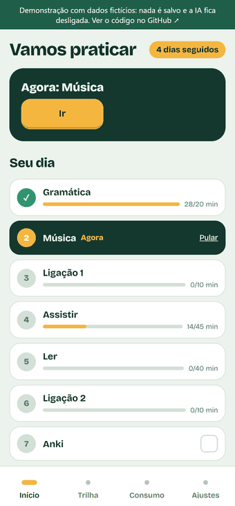
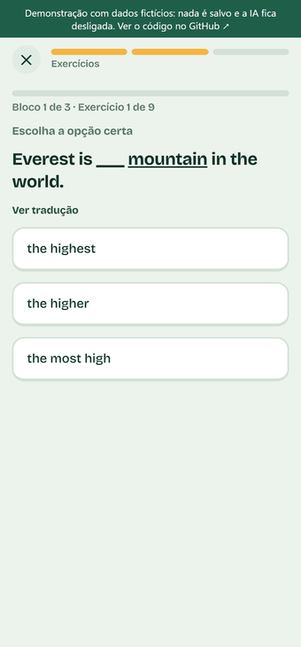
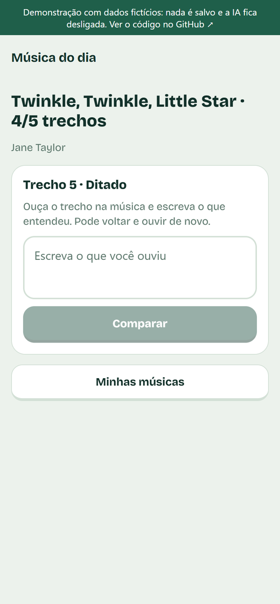
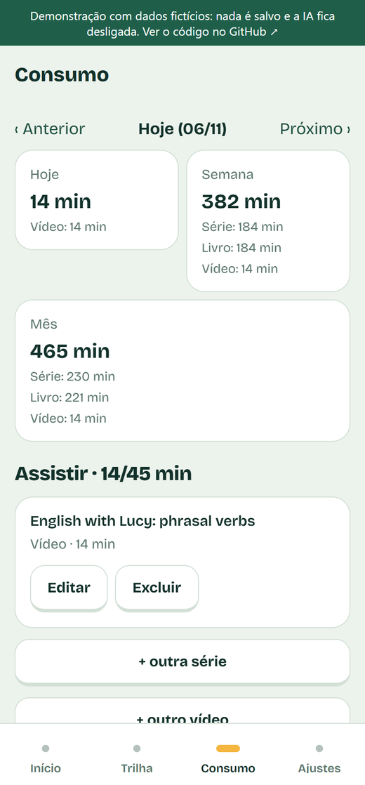

# English: a B1 → C1 English course with AI

**English** · [Português](README.pt-BR.md)

An Android app, with a web version on localhost, for training English from B1 to C1. It has:
- a **guided study day in 7 blocks**;
- **1,242 hand-written exercises**, graded without AI;
- **spaced repetition** and **level exams**;
- **songs with dictation and shadowing**;
- **unlimited conversation with AI**;
- **minute tracking** for calls, TV series and reading.

This is a GenAI portfolio project. All the AI lives in a Python backend, behind provider interfaces that can be swapped through configuration.

**▶ [Live demo](https://lucasalan03.github.io/English-Course-Curso-de-Ingl-s/)**: a web showcase with sample data (the interface is in Portuguese; best viewed at phone width). You can browse every screen and answer the lesson exercises, which are graded in the browser. Nothing is saved and the AI is off.

| Tour | Doing exercises |
|---|---|
|  |  |

| Your day | Track | Song of the day | Media log |
|---|---|---|---|
|  |  |  |  |

- Design spec: [docs/superpowers/specs/2026-11-03-english-app-design.md](docs/superpowers/specs/2026-11-03-english-app-design.md)
- Implementation plan: [docs/superpowers/plans/2026-11-03-english-app.md](docs/superpowers/plans/2026-11-03-english-app.md)
- Daily plan, exercises, exams and songs: [spec](docs/superpowers/specs/2026-11-05-daily-plan-design.md) · [plan](docs/superpowers/plans/2026-11-05-daily-plan.md)

## What the app does

- **The day in 7 blocks**, each one unlocking the next: Grammar (10–20 min) → Song → Call 1 (10 min) → Watch (45 min) → Read (40 min) → Call 2 (10 min) → Anki. You can skip a block and come back to it. The streak counts the days with all 7 blocks done. On Android, local reminders arrive at the times you choose.
- **46 modules** (B1: 19, B2: 16, C1: 11). Each has short theory and **27 exercises** in 3 blocks: recognize → practice → produce.
  - **Exercise types:** multiple choice, listening, fill in the gap, dictation, fix the mistake, word order, transformation and translation.
  - They are **graded without AI** and come with a translation of the instructions and a glossary.
- **Spaced repetition:** the module grade decides when it comes back. A review brings 9 exercises from the module's own bank, starting with the ones you got wrong.
- **Level exams:** 30 questions drawn from a bank of 40 per level. You need 75% to unlock the next level.
- **Songs:** you paste the lyrics, which stay only in your local database. Every day, the app gives you dictation and shadowing on one section, until the final challenge of singing the whole song. Once per song, the AI points out where the course grammar appears in it.
- **Calls:**
  - **Call 1** is a conversation set in the module's scenario.
  - **Call 2** is **Teach the AI**: you explain the topic to a confused student.
  - The app tracks the time, and you can also log calls made elsewhere. The report can be downloaded as Markdown.
- **Tap to translate:** works on any English word in the conversation, the theory and the lyrics. Saved words become a CSV for Anki.
- **Minute tracking:** TV series (episodes × minutes), YouTube videos (the title is fetched from the link) and reading (pages and new words).

## Architecture

```
App (Expo / TypeScript)  ──HTTP/JSON──►  Backend (Python / FastAPI)  ──►  Gemini · Claude · OpenAI · local Whisper/Piper
  Android + Web (localhost)                SQLite · curriculum · spaced repetition · cost control
```

- **App** (`app/`): interface only. It holds no keys and no business rules.
- **Backend** (`backend/`): progress (SQLite), curriculum (`content/modules`), prompts (`prompts/`), spaced repetition, costs and all the AI.
- **Providers** (`backend/app/providers/`): `chat`, `report`, `stt` (speech → text) and `tts` (text → speech). Each has a free and a paid implementation.

### AI profiles

| Role | `free` profile (default) | `paid` profile |
|---|---|---|
| Conversation | Gemini (free tier) | Claude Haiku |
| Reports and exercises | Gemini (free tier) | Claude Sonnet |
| Speech → text | Local Whisper (`faster-whisper`) | OpenAI |
| Text → speech | Local Piper | OpenAI |

Switch with `PROVIDER_PROFILE=free|paid` in the backend `.env` and restart. You can mix providers with `CHAT_PROVIDER`, `REPORT_PROVIDER`, `STT_PROVIDER` and `TTS_PROVIDER` (`gemini`, `local`, `anthropic`, `openai`). Model IDs are configurable too (see `.env.example`).

Notes on the free profile:
- The local voice sounds more robotic.
- Free Gemini has a request limit, and the app warns you when you reach it.
- On the free tier, Google may use the data sent to improve its models.

### Costs (paid profile)

The paid providers use **prepaid credits**. Buy credits in each provider's console (Anthropic and OpenAI), keep **auto-reload off** and set a **monthly limit** there.

The app keeps an **estimate** of the month's spending. It is not the real balance. The app warns you at `MONTHLY_WARN_BRL` (R$ 45) and blocks paid calls at `MONTHLY_CAP_BRL` (R$ 50). If a provider runs out of credit, the app shows which one needs a top-up.

> Prices and models change, so check the official pricing pages. The values in `backend/app/pricing.py` are estimates.

## How to run

### Backend

```bash
cd backend
python -m venv .venv
.venv\Scripts\activate                       # Windows (Linux/macOS: source .venv/bin/activate)
pip install -e ".[dev,free]"                 # add ,paid for Claude and OpenAI
copy .env.example .env                       # fill in API_TOKEN and GEMINI_API_KEY
```

1. Create a Gemini key at <https://aistudio.google.com/apikey> and put it in `GEMINI_API_KEY`.
2. Download the Piper voice into `backend/data/voices/`:
   - <https://huggingface.co/rhasspy/piper-voices/resolve/main/en/en_US/lessac/medium/en_US-lessac-medium.onnx>
   - <https://huggingface.co/rhasspy/piper-voices/resolve/main/en/en_US/lessac/medium/en_US-lessac-medium.onnx.json>
3. Check everything: `python scripts/smoke.py`. It should show `[OK]` for all four providers.
4. Start the server: `uvicorn app.server:app_factory --factory --host 0.0.0.0 --port 8000`

The local Whisper model (`base`) downloads itself on the first transcription.

### App

```bash
cd app
copy .env.example .env     # EXPO_PUBLIC_API_URL and EXPO_PUBLIC_API_TOKEN (the same API_TOKEN as the backend)
npm install
npm run web                # web version at http://localhost:8081
npx expo start             # Android: scan the QR code with Expo Go
```

On a phone, use `EXPO_PUBLIC_API_URL=http://<your-PC-IP>:8000`:
- the phone and the PC must be on the same Wi-Fi network;
- port 8000 must be open in the Windows firewall.

Test the microphone in **Settings → Test microphone**.

### Tests

```bash
cd backend && python -m pytest        # backend, with fake providers (costs nothing)
cd app && npx jest && npx tsc --noEmit
```

Course content lives in three folders:
- theory: `backend/content/modules/`;
- exercises: `backend/content/exercises/`;
- exams: `backend/content/exams/`.

The tests validate all of it: the split of the 27 exercises, exactly one correct option, a glossary that doesn't give away the answer, and more.

After changing listening or dictation exercises, record their audio once with Piper: `python scripts/prefill_audio.py` (or `--only <id>`). The "Report exercise" button flags a suspicious exercise to fix later.

### Live demo build

The demo is the web app built with `EXPO_PUBLIC_DEMO=1`. In this mode the app never calls the backend:
- it reads responses recorded by `backend/scripts/build_demo_data.py`, which simulates about 12 days of study with fake providers (no AI, no cost);
- it grades lesson exercises in the browser with the same rules as the backend (`app/src/demo.ts`);
- it refuses every other write with a "this is a demo" notice.

```bash
cd backend && python scripts/build_demo_data.py ../demo/demo-data.json --audio-from data/audio --audio-out ../demo/audio
cd app && set EXPO_PUBLIC_DEMO=1&& set EXPO_PUBLIC_DEMO_BASE=/English-Course-Curso-de-Ingl-s&& npx expo export -p web --output-dir ../demo
```

Then copy `index.html` to `404.html` (for GitHub Pages) and publish the folder. Only synthetic exercise audio is published, never conversations or song lyrics.

## Security and privacy

- Keys live only in `.env`, which is outside Git. The web and Android app know only the `API_TOKEN`.
- `backend/data/` is outside Git. It holds the database, audio files, voices and the **song lyrics**. Lyrics never go into versioned files.
- The token travels in a header (`X-API-Token`). For audio it goes in the URL (`?token=`), because media players don't send headers. Use it only on a trusted network.

## Next steps (v2)

- Performance analysis with automatic suggestions ("you are weak in X").
- Hosting the backend for use away from home.

Reminders work in the Android app. On the web there is only the card for the next block.
